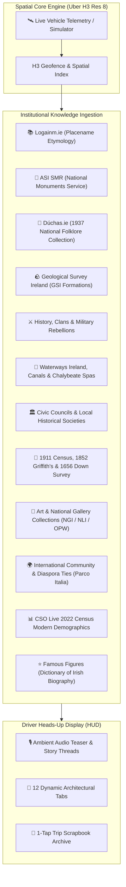

# Where Am I? (Anseo) 🇮🇪
### *Éire Spatial-Hybrid Heritage & Knowledge Engine*

[](https://github.com/BBSISK/where-am-i/actions/workflows/ci.yml)
[](https://www.typescriptlang.org/)
[](https://react.dev/)
[](https://h3geo.org/)
[](https://elevenlabs.io/)
[](https://tailwindcss.com/)
[](https://opensource.org/licenses/MIT)

> **Where Am I? (Anseo)** partitions the island of Ireland into an in-memory spatial mesh of ~0.74 km² hexagonal units (**Uber H3 Resolution 8**). Operating with sub-millisecond $O(1)$ client-side lookups, the engine passively tracks vehicular movement, automatically detects townland boundary crossings, and streams automotive-grade oral history, fine art, folklore, and live census intelligence through a high-contrast driver heads-up display (HUD) and hands-free voice copilot.

---

## 🌟 Core Capabilities & System Overview

### 1. 🛰️ Dual Driving Telemetry Modes
* **Live In-Car Vehicle GPS**: Real-time geolocation with heading, velocity (km/h), accuracy thresholds, and Screen Wake Lock API integration to keep phones awake on car dashboard mounts.
* **Corridor Simulation Engine**: High-fidelity demo simulator supporting multiple historic Irish routes (e.g., N4/M4 Royal Liffey & Pale Corridor, Galway to Clifden Connemara Way, The Pale to Glendalough).

### 2. ⚡ Client-Side Spatial RAG Engine
* **Zero Cloud Latency**: 100% in-browser geofenced retrieval. Every townland and heritage document is partitioned into searchable RAG chunks indexed by Uber H3 Res 8 hexagons with Haversine highway corridor proximity fallback (< 6.5 km).
* **Deterministic Fact Guard**: Eliminates AI hallucination by assembling prompts strictly from verified institutional archives before audio synthesis.
* **Ambient Audio Teaser Auto-Dispatch**: Automatically triggers a 10-second contextual audio breadcrumb as soon as satellite signal is acquired or when crossing into a new townland cell, protected by stateful deduplication to eliminate audio stutter or clipping.
* **Progressive Non-Repeating Story Threads ("Tell Me More")**: Sequential narrative advancement allowing drivers to tap or voice-trigger deeper stories (Thread 1 → Thread 2 → Thread 3 → Deep Townland Lore) without repeating topics.

---

## 🏛️ Comprehensive Cultural & Institutional Ingestion

Where Am I? aggregates verified open cultural data across deep institutional dimensions:



### 1. The 6 Foundational Heritage Pillars
* **Placename Etymology (Logainm.ie & Royal Irish Academy)**: Gaelic root decomposition (*Leamhán, Áth, Léim, Maigh, Nuadha*) with phonetic pronunciation guides.
* **Archaeological Sites & National Monuments (ASI SMR)**: 140,000+ indexed monuments with SMR catalogue identifiers, proximity metrics, and architectural typologies (e.g., King John's Bridge c. 1200, Leixlip Castle 1172, Maynooth Castle 1203).
* **Oral Folklore & Legends (Dúchas.ie)**: Authentic stories from the 1937–38 Irish Folklore Commission Schools’ Scheme, citing original archival volumes, schools, and child informants.
* **Geological Formations (Geological Survey Ireland - GSI)**: Calp limestone gorges, geothermal chalybeate fissures, waulsortian reef drift plains, and glacial eskers.
* **History, Clans & Rebellions**: Jacobite Wars, Tudor Sieges, United Irishmen rebellions, and clan histories (Sarsfield, FitzGerald, Conolly, Guinness).
* **Waterways, Canals & Spas**: River Liffey, Rye Water (Abhainn na Rí), Royal Canal navigation locks, and 18th-century hydrotherapy spa springs.

### 2. Civic Local Authorities & Local Historical Societies
* **South Dublin County Council (SDCC)** & **Society for Old Lucan (SOL)**: Preserving King John's Bridge, Shackleton's Anna Liffey Flour Mills, and local heritage walking trails.
* **Kildare County Council** & **Leixlip History Club**: Industrial canal heritage, Rye Water aqueducts, and 1755 Arthur Guinness civic heritage plaques.
* **Maynooth Tidy Towns** & **St. Patrick's College Archives**: The 750-year-old Silken Thomas Yew tree, Carton Duke's Avenue, and historic college grounds.

### 3. Historical Census & Land Records
* **1911 Census of Ireland (National Archives of Ireland)**: Verified population totals, house construction (slate vs. thatch roofs), literacy rates, Irish-language speakers, and living occupations (flour millers, steam tram motormen, canal bargemen, coopers, scholars).
* **Famine Depopulation Metrics (1841 vs. 1851)**: Quantifying the local impact of An Gorta Mór on agricultural labor.
* **Griffith’s Primary Valuation (1852/1853)**: Primary landlords (e.g. Viscount de Vesci, Duke of Leinster, Thomas Conolly), tenement counts, and predominant family surnames.
* **1656 Down Survey (Trinity College Dublin GIS / Sir William Petty)**: 1641 Gaelic Catholic proprietors vs. 1656 Cromwellian grantees and terrain notes.

### 4. Wide-Net Ingestion Dimensions
* **🎨 Fine Art & National Collections**:
  * **National Gallery of Ireland (NGI)**: Francis Wheatley RA (*The Salmon Leap, Leixlip*, 1783, Cat. NGI.4363), William Ashford PRHA (*View of Lucan House and Bridge*, c. 1795), Thomas Roberts (*A View of Carton Demesne*, 1776), James Arthur O'Connor (*The Liffey Valley near Lucan*, c. 1828).
  * **National Library of Ireland (NLI)**: Jane Wigham Shackleton photographic archive of over 1,000 glass-plate negatives (1885–1906).
  * **Office of Public Works (OPW)**: Swiss-Italian Francini brothers' 1739 High Baroque ceiling at Carton House (*The Courtship of the Gods*), and Augustus Welby Pugin's neo-Gothic quadrangle and cloisters (1845).
* **🌍 International Community & Diaspora Ties**:
  * **The Italian Connection & Parco Italia (🇮🇹)**: Lucan House's 70-year residency as the official residence of the Italian Ambassador to Ireland (1954–2024), culminating in the historic May 2024 €10.5M transfer to South Dublin County Council attended by Italian President Sergio Mattarella and President Michael D. Higgins to create *Parco Italia*.
  * **Norse Viking Frontiers (🇳🇴)**: Old Norse *Lax-hlaup* (Salmon Leap), establishing the western border of the 9th-century Viking Kingdom of Dublin (*Dyflin*).
  * **Silicon Valley Tech Corridor (🇺🇸)**: Intel Ireland's European semiconductor manufacturing campus ($20B+ capital investment, Fab 34 featuring Extreme Ultraviolet / EUV lithography).
  * **French Revolution Sorbonne Scholars (🇫🇷)**: St. Patrick's College founded in 1795 with French refugee academics fleeing the French Revolution (Fr. François Anglade, Fr. André Darré).
* **📊 Central Statistics Office (CSO) Live 2022 Census Pulse**:
  * **Lucan**: Grew from 792 residents in 1911 to **57,575** in 2022 (**+7,169% growth**), one of Ireland's youngest (median age 35.2) and most multicultural towns (28.4% speak an international language at home).
  * **Leixlip**: Grew from 846 in 1911 to **16,733** in 2022 (**+1,877% growth**), with 62.4% of working adults holding third-level STEM degrees.
  * **Maynooth**: Grew from 1,385 in 1911 to **17,259** in 2022 (**+1,146% growth**), holding the youngest median age in Ireland (**28.4 years**) and hosting 15,000+ university researchers.
* **⭐ Famous Local Figures**:
  * **Paul Mescal** (b. 1996, Maynooth): Academy Award and BAFTA-nominated actor (*Normal People*, *Gladiator II*), former Kildare minor GAA captain.
  * **Rev. Prof. Nicholas Callan** (1799–1864, Maynooth): Inventor of the induction coil (1836, IEEE Milestone in Electrical Engineering).
  * **Patrick Sarsfield, 1st Earl of Lucan** (1660–1693): Jacobite cavalry hero of the 1690 Siege of Limerick and leader of the Wild Geese.
  * **Arthur Guinness** (1725–1803, Leixlip): Began commercial brewing on Leixlip Main Street in 1755 prior to Dublin.
  * **Hon. Desmond & Mariga Guinness** (Leixlip Castle): Co-founders of the Irish Georgian Society (1958).
  * **Arthur Cox** (1891–1965, Lucan House): Founder of Arthur Cox solicitors and Irish Free State legal draughtsman.

---

## 🎙️ Audio Architecture & Voice Engine

```
                             ┌─────────────────────────────┐
                             │   GPS Signal Acquired       │
                             │   / H3 Cell Entry Event     │
                             └──────────────┬──────────────┘
                                            │
                                            ▼
                             ┌─────────────────────────────┐
                             │  Audio Dispatcher Mutex     │
                             │  (Exclusive Single Stream)  │
                             └──────────────┬──────────────┘
                                            │
                      ┌─────────────────────┴─────────────────────┐
                      │                                           │
                      ▼                                           ▼
          [ElevenLabs Configured]                     [Web Speech Fallback]
                      │                                           │
                      ▼                                           ▼
       ┌─────────────────────────────┐             ┌─────────────────────────────┐
       │ ElevenLabs Turbo v2.5       │             │ Native Web Speech API       │
       │ Official Premade Voices:    │             │ Filtered Male Synthesis     │
       │ • Callum (Husky Celtic)     │             │ (George / Daniel / Oliver)  │
       │ • George (Warm Heritage)    │             │ Zero Cloud Overhead         │
       │ (Free-Tier Safe / No 400s)  │             └─────────────────────────────┘
       └──────────────┬──────────────┘                            │
                      │                                           │
                      └─────────────────────┬─────────────────────┘
                                            │
                                            ▼
                             ┌─────────────────────────────┐
                             │  Ducking & Speech Guard     │
                             │  (Mute mic during speech)   │
                             └─────────────────────────────┘
```

* **Exclusive Audio Mutex**: Eliminates overlapping audio by killing in-flight network fetches via `AbortController` and enforcing strict single-session execution.
* **Microphone Ducking**: Voice recognition copilot automatically ducks its microphone during system speech, preventing voice loops and acoustic feedback.
* **ElevenLabs Free-Tier Immunity**: Defaults to guaranteed official premade voices (*Callum* `N2lVS1w4EtoT3dr4eOWO`, *George* `JBFqnCBsd6RMkjVDRZzb`), preventing HTTP 400 errors encountered when Free Tier accounts attempt custom library voices.
* **1-Tap Trip Scrapbook**: Archives pulled audio threads to `localStorage` with replay capabilities, H3 spatial stamps, and timestamps.

---

## 🏗️ System Architecture & Data Model

```typescript
export interface AreaKnowledgeUnit {
  areaId: string;
  townland: string;
  irishName: string;
  phonetic: string;
  county: string;
  parish: string;
  coordinates: GeoCoordinate;
  h3Indices: string[];
  aliases?: string[];
  councilSource?: CouncilHeritageSource;
  census?: CensusDemographics;
  artReferences?: ArtReference[];
  communityLinks?: CommunityDiasporaLink[];
  csoModern?: CsoModernMetrics;
  famousFigures?: FamousFigure[];
  etymology: EtymologyInfo;
  monuments: NationalMonument[];
  folklore: FolkloreStory;
  geology: GeologicalFeature;
  history?: HistoryEvent;
  waterways?: WaterwayInfo;
  teaserScript: string;
  narrativeScript: string;
  threads: ThreadOption[];
}
```

### Spatial Grid Benchmark ($O(1)$ Retrieval)
| Parameter | Value | Engineering Significance |
| :--- | :--- | :--- |
| **Grid Index** | Uber H3 Resolution 8 | ~0.737 km² per cell, 461 m average edge length |
| **Corridor Range** | K-Ring 1 (~5 km²) | Covers primary route plus immediate parallel highways |
| **Lookup Latency** | `< 2 ms` | In-memory `Map<string, AreaKnowledgeUnit>` bitwise indexing |
| **Proximity Fallback** | Haversine `< 6.5 km` | Seamlessly bridges suburban district boundaries |

---

## 📁 Repository Structure

```
where-am-i/
├── docs/
│   ├── adr/                      # Architecture Decision Records
│   │   ├── ADR-001-Spatial-Grid-H3-vs-Geohash-vs-Rectangular.md
│   │   ├── ADR-002-Agentic-Orchestration-LangGraph-vs-Sequential-Chains.md
│   │   └── ADR-003-Offline-First-Mobile-Drive-Mode-Caching.md
│   └── sprints/
│       └── SPRINT_BACKLOG.md     # Agile user stories & backlog
├── src/
│   ├── components/               # DriveModeView, MapExplorer, DevShowcase, Modals
│   ├── data/
│   │   ├── n4CorridorData.ts     # Deep Lucan-Leixlip-Maynooth 12-pillar corpus
│   │   ├── heritageKnowledgeBase.ts # Nationwide townland catalog
│   │   └── irelandRoutes.ts      # Simulated highway corridor waypoints
│   ├── services/
│   │   ├── spatialRagService.ts  # In-memory spatial RAG indexing & semantic search
│   │   ├── spatialEngine.ts      # Uber H3 conversions, bearings & Haversine math
│   │   ├── audioNarrationService.ts # ElevenLabs + Web Speech exclusive audio dispatcher
│   │   ├── realGpsService.ts     # Live GPS watchPosition, wake lock & telemetry
│   │   ├── voiceCommandService.ts # Hands-free voice recognition & mic ducking
│   │   └── dynamicHeritageService.ts # Cell enrichment pipeline
│   ├── types/                    # Strict TypeScript schemas
│   ├── App.tsx                   # Top-level state coordinator
│   └── main.tsx
├── package.json
├── tailwind.config.js
└── vite.config.ts
```

---

## 🚀 Quickstart & Development

### 1. Prerequisites
* **Node.js** v18+
* **npm** or **pnpm**

### 2. Installation
```bash
git clone https://github.com/BBSISK/where-am-i.git
cd where-am-i
npm install
```

### 3. Environment Configuration (Optional)
To enable ElevenLabs Celtic storytelling voices:
```bash
cp .env.example .env
# Add your key:
VITE_ELEVENLABS_API_KEY=your_elevenlabs_api_key_here
```
*(If no API key is provided, the engine automatically falls back to native Web Speech male synthesis with zero configuration.)*

### 4. Development Server
```bash
npm run dev
```
Open [http://localhost:5173](http://localhost:5173) in your browser.

### 5. Run Verification & Tests
```bash
# Run Vitest unit tests (31 unit tests covering RAG, audio, and GPS)
npm run test

# Production build check
npm run build
```

---

## 📜 Cultural & Data Citations

* **Logainm.ie**: The Placenames Database of Ireland, developed by Fiontar & Scoil na Gaeilge (DCU) and the Department of Tourism, Culture, Arts, Gaeltacht, Sport and Media.
* **National Monuments Service (ASI)**: Archaeological Survey of Ireland, Department of Housing, Local Government and Heritage.
* **Dúchas.ie**: National Folklore Collection, University College Dublin (UCD).
* **Geological Survey Ireland (GSI)**: Department of the Environment, Climate and Communications.
* **National Archives of Ireland (NAI)**: 1911 Census of Ireland & 1851 Great Famine Mortality Returns.
* **Central Statistics Office (CSO)**: Census 2022 & 2016 Demographic Profiles.
* **National Gallery of Ireland (NGI)**: Permanent Collections & Topographical Landscape Archives.
* **National Library of Ireland (NLI)**: Prints & Drawings, Shackleton Glass-Plate Collection.
* **AskAboutIreland / Valuation Office**: Griffith’s Primary Valuation of Tenements (1852–1853).
* **Trinity College Dublin (TCD GIS)**: The Down Survey of Ireland (1656–1658).

---

## ⚖️ License
Released under the [MIT License](LICENSE).
